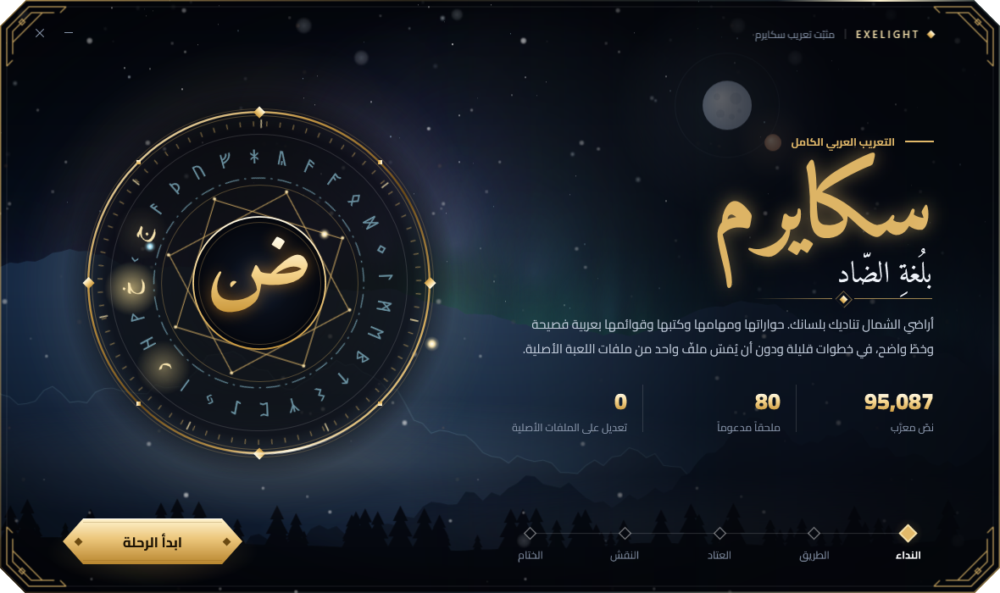
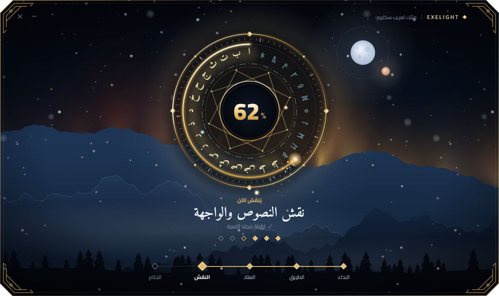

<div align="center">



# سكايرم بلُغة الضّاد

**تعريب كامل للعبة Skyrim Special Edition**<br>
الحوارات، والمهام، والكتب، والقوائم، بعربية فصيحة وخط واضح


### [⬇ تحميل المثبّت 0.9.9](https://github.com/exelight7/skyrim_AR/releases/latest)

[العربية](#-نظرة-سريعة) · [English](#english) · [التوثيق](docs/) · [سجل التقدم](STATUS.md)

</div>

<br>

<div dir="rtl">

## ✦ نظرة سريعة

تعريب للعبة الأساسية وإضافاتها الثلاث ومحتوى Creation Club، أي **80 ملحقاً** في المجموع. الحروف متصلة، والنص من اليمين إلى اليسار، والتشكيل يُعالج وقت البناء، **دون تعديل أي ملف EXE أو DLL**.

| | |
|---|---|
| **النصوص المعرَّبة** | 94,063 من 94,384 نصاً ظاهراً للاعب |
| **الكلمات** | نحو 1.23 مليون كلمة |
| **الواجهة** | 861 من 861 مفتاحاً |
| **الباقي** | 321 نصاً من نصوص الكتب، تظهر بالإنجليزية |

## ✦ ما الذي عُرِّب

| القسم | الحالة |
|---|:---:|
| الحوار المنطوق (44,255 سطراً) | ✅ |
| خيارات اللاعب ومواضيع الحوار | ✅ |
| المهام: الأسماء والأهداف والمذكرات | ✅ |
| الأغراض والتعاويذ والمزايا وأوصافها | ✅ |
| أسماء الأماكن والشخصيات | ✅ |
| الرسائل وشاشات التحميل | ✅ |
| الواجهة والقوائم | ✅ |
| عناوين الكتب | ✅ |
| نصوص الكتب | 🔶 1,118 من 1,439 |

## ✦ المثبّت

<div align="center">

</div>

<br>

**[حمّل المثبّت من صفحة الإصدارات](https://github.com/exelight7/skyrim_AR/releases/latest)**، شغّله، واختر مجلد اللعبة. ملف واحد لويندوز 10 و11 يضع التعريب في مجلد اللعبة ويزيله:

- يضيف التعريب **ملفاتٍ مستقلة** في `Data`، ولا يفتح ملفات اللعبة الأصلية للكتابة.
- يحفظ أي ملف موجود في مكان ملفاته، ويعيده عند الإزالة.
- يسجّل ما ثبّته ببصمة SHA-256، فلا يزيل إلا ملفاته.
- يتراجع عن كل شيء إذا فشل التثبيت في منتصفه.

## ✦ التوافق

> ⚠️ **تنبيه**<br>
> تشحن الحزمة 24 قائمة واجهة SWF معدّلة، فتتعارض مع مودات الواجهة مثل **SkyUI**.

- مبنيّ للإصدار **1.7.104.0** من Skyrim Special Edition. على إصدار آخر قد تغيب بعض النصوص.
- اللعبة يجب أن تعمل باللغة الإنجليزية، لأن التعريب يحلّ محل ملفاتها.

## ✦ البناء

للبناء من المصدر تحتاج نسختك الخاصة من اللعبة. الخطوات مفصّلة في التوثيق:

1. جهّز الأدوات: [`docs/02_TOOLCHAIN.md`](docs/02_TOOLCHAIN.md)
2. استخرج النصوص وابنِ الحزمة: [`docs/09_TRANSLATION_PIPELINE.md`](docs/09_TRANSLATION_PIPELINE.md)
3. ابنِ المثبّت، فيضمّ الحزمة تلقائياً:

</div>

```bash
dotnet build 05_tools/installer_ui/SkyrimArabic.csproj -c Release
```

<div dir="rtl">

## ✦ محتوى المستودع

| المجلد | المحتوى |
|---|---|
| [`03_translation/ar/`](03_translation/ar/) | الترجمة العربية، ملف TSV لكل ملحق (`key<TAB>arabic`) |
| `03_translation/glossary.*` | المسرد المعتمد للمصطلحات والأسماء |
| [`04_fonts/`](04_fonts/) | خطا Cairo وAmiri (رخصة OFL) وأدوات بناء خط SWF |
| [`05_tools/`](05_tools/) | أدوات الاستخراج والفحص والبناء والتثبيت |
| [`docs/`](docs/) | المعمارية، ودليل الأسلوب، وسياسة المصطلحات، وخط الإنتاج |
| [`DECISIONS.md`](DECISIONS.md) · [`STATUS.md`](STATUS.md) | سجل القرارات وسجل التقدم |

### ما لا يحتويه

لا يحتوي كود المستودع على أي ملف من ملفات اللعبة، ولا على نصوصها الإنجليزية الأصلية، ولا على تعديلات قوائم الواجهة. الحزمة المبنية تُنشر في صفحة الإصدارات فقط. Skyrim ونصوصها ملك لـ Bethesda.

</div>

---

## English

**Arabic localization of Skyrim Special Edition 1.7.104.0**, covering the base game, all three DLCs and Creation Club content (80 plugins).

- **99.66%** of player-visible strings are translated (94,063 of 94,384, about 1.23 million words). 321 book texts remain in English.
- Arabic shaping, right-to-left ordering and line wrapping are done at build time. No EXE or DLL is patched.
- A Windows installer ([download from Releases](https://github.com/exelight7/skyrim_AR/releases/latest)) places the translation as loose files, backs up anything it would replace, and removes only its own files on uninstall.
- The package ships 24 modified interface SWF menus, so it conflicts with UI mods such as SkyUI.

This repository contains only the Arabic translations (`03_translation/ar/`), the glossary, fonts, tools and docs. It contains no game files and none of Bethesda's original text; the built package is published on the Releases page only. To build from source you need your own copy of the game. See [`docs/02_TOOLCHAIN.md`](docs/02_TOOLCHAIN.md) and [`docs/09_TRANSLATION_PIPELINE.md`](docs/09_TRANSLATION_PIPELINE.md).

## License

| | |
|---|---|
| Code | MIT, see [`LICENSE`](LICENSE) |
| Fonts | SIL Open Font License, see `04_fonts/src/*/OFL.txt` |
| Skyrim and its text | Property of Bethesda Softworks |

<div align="center">
<br>
<sub>E X E L I G H T</sub>
</div>
